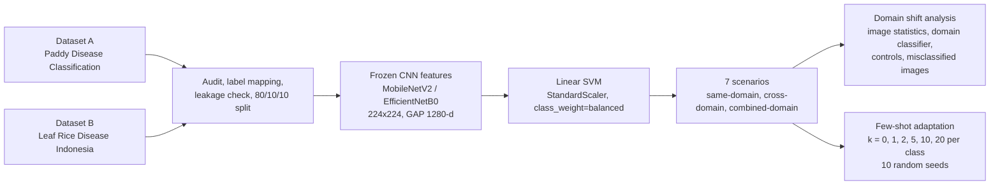

# 🌾 Cross-Domain Generalization and Domain Adaptation for Rice Leaf Disease Classification

   

Code and experiment notebooks for the manuscript **"Cross-Domain Generalization and Domain Adaptation for Rice Leaf Disease Classification"** (Universitas Dian Nuswantoro).

## 🎯 Why this research?

Most rice leaf disease classifiers are trained and tested on images from the **same source**, so the reported accuracy is high. In the field, images come from different cameras, lighting, and backgrounds. This **domain shift** can lower performance sharply when a model meets data from another source.

This study asks three practical questions:

1. **How much does performance drop** when a model is trained on one dataset and tested on another (generalization gap)?
2. **What differs between the datasets** (background, brightness, colour, class balance), and do these differences explain the drop?
3. **How much of the drop can be recovered** by adding only a few labelled target images per class (few-shot adaptation)?

## 🔬 What we did

- **Classes (3):** bacterial leaf blight, blast, tungro.
- **Models:** MobileNetV2-SVM and EfficientNetB0-SVM (frozen ImageNet features, no fine-tuning).
- **Scenarios:** S1 A→A, S2 B→B (same-domain); S3 A→B, S4 B→A (cross-domain); S5 A+B→A+B, S6 A+B→A, S7 A+B→B (combined-domain).
- **Main metric:** macro F1-score, with 95% confidence intervals (bootstrap over test images; t-based over seeds for few-shot).

## 📊 Main results

| Setting | MobileNetV2-SVM | EfficientNetB0-SVM |
|---|---|---|
| S1 same-domain (A→A) | 0.9103 | 0.9266 |
| S5 combined-domain (A+B→A+B) | 0.9133 | 0.9419 |
| S6 combined-domain (A+B→A) | 0.9136 | 0.9353 |
| S3 cross-domain (A→B) | 0.3561 | 0.3262 |
| S4 cross-domain (B→A) | 0.2657 | 0.3087 |
| A→B, 20 images/class | 0.7521 | 0.7198 |
| B→A, 20 images/class | 0.5208 | 0.5611 |

**Takeaways**
- Macro F1 is above 0.91 when training and test data come from the same source, but falls to 0.27–0.36 across datasets.
- The two datasets differ clearly in background, brightness, and colour saturation, and a simple classifier separates them perfectly (AUC = 1.000).
- Data size and class balance alone do not explain the drop. Colour and lighting controls help in one direction only, so more than one factor is probably involved.
- A few labelled target images recover part of the performance (clear gains from k = 5), but results remain below same-domain performance and vary with the images chosen.

> These findings apply to the tested conditions only: two public datasets, three disease classes, and adaptation by retraining a Linear SVM on frozen CNN features.

## 📁 Notebooks (run in this order)

| # | Notebook | Purpose |
|---|---|---|
| 01 | `01_Dataset_Audit_and_Preparation.ipynb` | Read both datasets, build manifests, map labels, detect corrupt/duplicate images (SHA-256, perceptual hash) |
| 01B | `01B_Dataset_Final_Validation.ipynb` | Final validation of the audited manifests |
| 02 | `02_master_split.ipynb` | Stratified group split (80/10/10), combined split, leakage report |
| 03 | `03_Baseline_MobileNetV2_CrossDomain.ipynb` | MobileNetV2 features + Linear SVM, scenarios S1–S7, C selection, bootstrap CIs |
| 04 | `04_Comparison_EfficientNetB0_CrossDomain.ipynb` | Same protocol with EfficientNetB0 |
| 05 | `05_FewShot_Calibration_MobileNetV2.ipynb` | Few-shot adaptation (k = 0–20, 10 seeds) for MobileNetV2 |
| 06 | `06_FewShot_Calibration_EfficientNetB0.ipynb` | Few-shot adaptation for EfficientNetB0 |
| 07 | `07_Domain_Shift_Analysis.ipynb` | Image statistics, domain classifier (AUC), size/class-balance control, colour and lighting controls |

## 🗂️ Data

The datasets are **not included** (see their licences on Kaggle):

- Dataset A: [Paddy Disease Classification](https://www.kaggle.com/competitions/paddy-disease-classification)
- Dataset B: [Leaf Rice Disease Indonesia](https://www.kaggle.com/datasets/tedisetiady/leaf-rice-disease-indonesia)

## ♻️ How to reproduce

1. Download both datasets from Kaggle and place them in your Google Drive.
2. Open the notebooks in Google Colab and run them in the order above.
3. Notebooks use the project path `/content/drive/MyDrive/eksperimen_baru`. Change it to your own Drive folder (set in the first cells of each notebook).
4. Seeds: 42, 52, 62, 72, 82 (cross-validation for choosing C) and 0–9 (few-shot sampling).

## 📝 Citation

If you use this work, please cite the manuscript (details will be added after publication):

> Nadya. Arum. Pramesti, Ajeng. Pembayung. Kartika. Sari, and Ricardus. Anggi. Pramunendra, "Cross-Domain Generalization and Domain Adaptation for Rice Leaf Disease Classification."

## 📬 Contact

Corresponding author: Ricardus Anggi Pramunendra (ricardus.anggi@dsn.dinus.ac.id), Faculty of Intelligent Technology, Universitas Dian Nuswantoro, Semarang.
